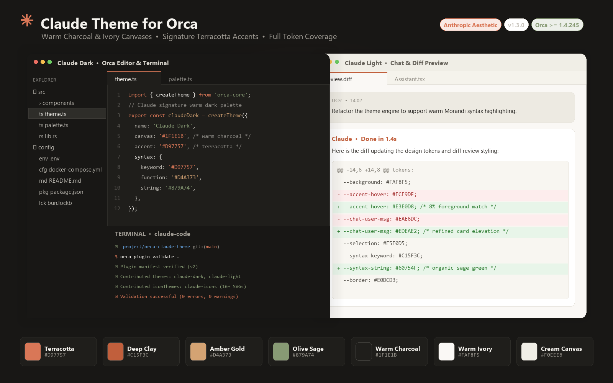

# Claude Theme for Orca

[中文文档](README.zh-CN.md) · English

An authentic **Claude Code** aesthetic theme for [Orca](https://github.com/stablyai/orca).

<p align="center">
  
</p>

---

## Features

- 🏛️ **4 Editorial Theme Variants**:
  - **Claude Dark**: Classic warm charcoal canvas (`#262624` / `#1A1A19`), signature terracotta (`#D97757`).
  - **Claude Dark (Midnight OLED)**: Deep pitch-black canvas (`#141413` / `#0C0C0B`), vibrant glowing accents.
  - **Claude Light**: Warm ivory paper canvas (`#FAF9F5` / `#F0EEE6`), readable charcoal ink (`#302D29`), and deep clay terracotta (`#A3442B`).
  - **Claude Light (Pure White)**: Clean high-contrast pure white canvas (`#FFFFFF` / `#F7F6F2`) for well-lit environments.
- 💬 **Full Orca Chat AI Suite (100% Token Coverage · 73/73 Tokens)**: User message bubbles, bold emphasis, muted timestamps, terracotta code pills, paper code blocks, and custom chat text selection.
- 🔀 **Diff & Git Highlighting**: Balanced line-level backgrounds and crisp character-level emphasis for fatigue-free code reviews.
- 💻 **4 Claude Terminal Presets**: Matching 16-color ANSI palettes, supporting Claude Terracotta and High-contrast Charcoal cursors, tuned for CLI coding agents (Claude Code CLI, Codex, etc.).
- 📁 **Semantic Folders & 29 Custom Icons**: Folder-aware icons for `src/`, `components/`, `docs/`, `test/`, `dist/`, `public/`, `config/`, `.git/`, and `node_modules/`, plus 29 language/file icons.
- 🎨 **Editorial Syntax Colors**: Refined Morandi TextMate token color scheme providing warm, distraction-free syntax highlighting with dedicated scopes for parameters, decorators, and regular expressions.
- ✨ **Unified Hover Hierarchy**: Cohesive, subtle hover highlights across top navigation items, worktrees, and file tree folders.

---

## Color Palette

| Token | Claude Dark | Claude Light | Description |
| :--- | :--- | :--- | :--- |
| **Accent (Primary)** | `#D97757` | `#A3442B` | Signature Terracotta / Deep Clay |
| **Canvas (Background)**| `#262624` | `#FAF9F5` | Warm Charcoal / Ivory Canvas |
| **Editor Surface** | `#1A1A19` | `#FFFFFF` | Code Editor & Terminal Surface |
| **Foreground** | `#ECE9E0` | `#302D29` | Primary Text Ink |
| **Muted Ink** | `#B9B3A7` | `#625D55` | Secondary & Subtitle Text |
| **Sidebar** | `#20201E` | `#F0EEE6` | Navigation & Worktree Tree |
| **Hover Accent** | `#2E2E2B` | `#E3E0D8` | Unified 8% Equivalent Hover Fill |
| **Chat Bubble** | `#33322E` | `#EDE8DE` | User Message Bubble Fill |
| **Inline Code Text** | `#EDA184` | `#91402B` | Backtick Code Pill Foreground |
| **Diff Added** | `#A4BF88` | `#3D5F2C` | Git Insertion Indicator |
| **Diff Removed** | `#E6A08B` | `#9E3B32` | Git Deletion Indicator |

---

## Recommended Claude Typography & Cursor Setup

For the authentic Anthropic Claude Code aesthetic inside Orca:

1. **Terminal 2px Slim Caret**:
   - Go to **Settings (`Ctrl + ,`) → Terminal**.
   - Change **`Cursor Style`** from `block` to **`bar`** (and optionally enable `Cursor Blink`).
2. **Editor Font**:
   - **Settings → Editor → Font Family**: `'JetBrains Mono', 'SF Mono', 'Fira Code', Consolas, monospace`.
   - **Line Height**: `1.6` for optimal reading flow.

---

## Installation

### From Orca Plugin Marketplace
Once indexed, search for **Claude Theme** under **Settings → Plugins** and click **Install**.

### From Local Path (For Development)
1. Clone or download this repository.
2. Open **Orca Desktop**.
3. Navigate to **Settings** (`Ctrl + ,` on Windows/Linux or `Cmd + ,` on macOS) → **Plugins**.
4. Click **"Install from local path"** and select this directory.
5. In **Settings → Appearance**, choose your preferred Claude theme variant, and set **File Icon Theme** to **Claude Icons**.

### Via Orca CLI
```bash
orca plugin dev load /path/to/orca-claude-theme
```

---

## License

[MIT](LICENSE)
